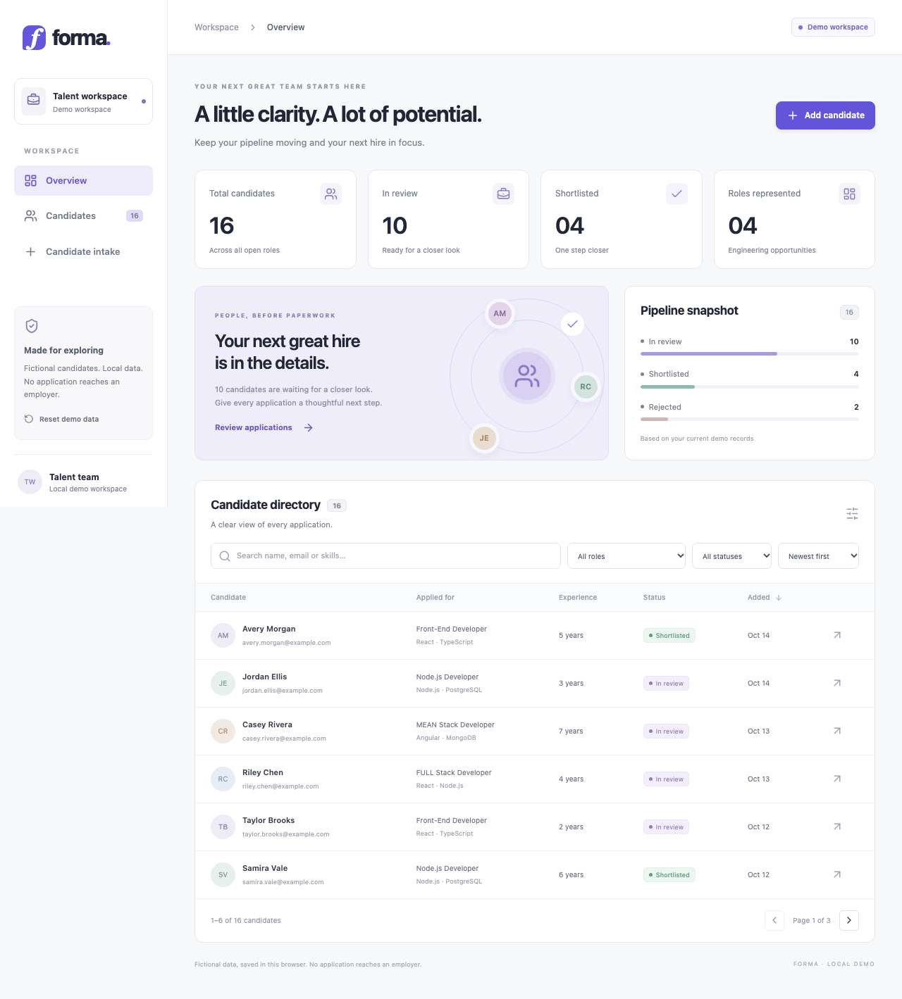
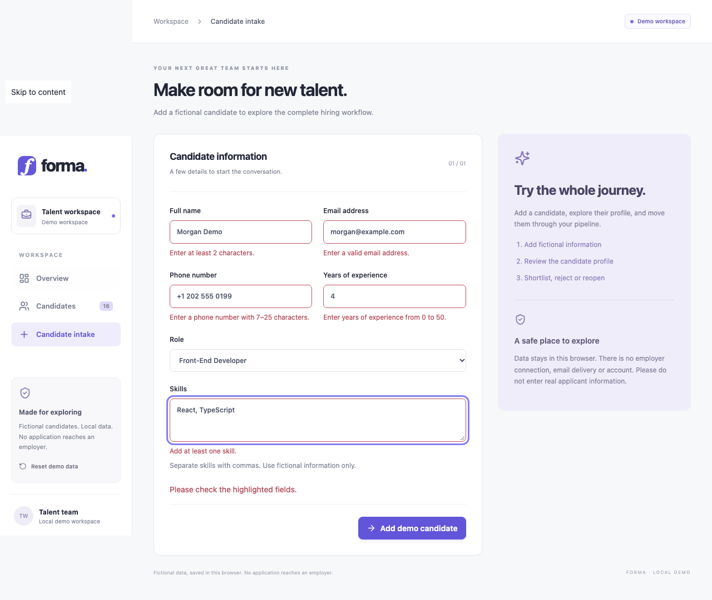
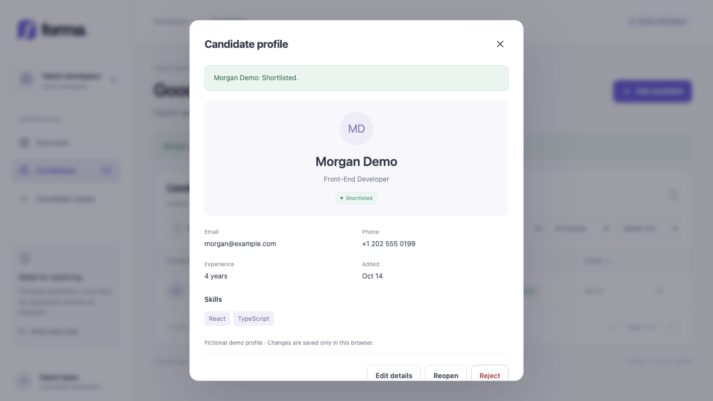
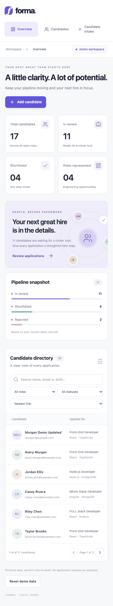

# Forma — Recruitment workspace

A frontend portfolio project that turns a legacy job-application interface into a cohesive recruitment dashboard. Forma makes a candidate pipeline easy to explore: review applications, inspect profiles, and move candidates between review, shortlist and rejection states.

**React 19 · TypeScript · Vite · React Router · Zod · Vitest · Playwright**

> **Interactive demo, not an application service.** Use fictional information only. Data stays in this browser; no application reaches an employer. There is no backend, authentication, email delivery or AI ranking.



## Explore the workflow

1. Start on **Overview** to see metrics calculated from the current candidate records.
2. Open **Candidates** to search by name, email or skills, combine role/status filters, sort and paginate. Query parameters preserve the view across reloads and shareable local URLs.
3. Use **Candidate intake** to add a fictional profile. Required fields and domain constraints are validated before saving.
4. Open a profile to edit details, shortlist, reject or reopen an application. Pending controls and inline feedback distinguish successful writes from failures.
5. Reload to confirm browser-local persistence, or use the confirmed **Reset demo data** action to restore the fixtures.

The interface adapts to desktop and mobile. Native dialogs support Escape, keyboard focus containment and restoration. Tables retain horizontal scrolling on small screens, and forms expose field-level validation errors.

<details>
<summary>More screenshots: intake, profile and mobile</summary>

### Candidate intake



### Profile and status actions



### Mobile overview



[View the mobile intake screenshot](artifacts/intake-mobile.png).

</details>

## Local setup

Use Node.js 22.12+ and npm 10+.

```sh
npm ci
npm run dev
```

Open the local URL printed by Vite. To inspect a production build locally:

```sh
npm run build
npm run preview
```

## Validation

```sh
npm run lint
npm run typecheck
npm test
npm run build
npx playwright install chromium --only-shell
npm run test:e2e
```

Playwright uses an isolated headless browser and a loopback server, not your personal browser profile. To use a separately downloaded test browser, set `PLAYWRIGHT_BROWSERS_PATH`; optionally set `CHROMIUM_PATH` to its executable. Tests cover form validation, combined filtering, sorting, status transitions, persistence validation/recovery, full intake-to-reload flow, editing, reset confirmation, save failure, keyboard focus containment/restoration, legacy redirects and mobile overflow. The full workflow also asserts that no external requests occur. CI performs a clean install, lint, typecheck, unit tests, build and Chromium end-to-end tests, uploading screenshots and failure traces. The implementation passed [GitHub Actions on commit `2c962f1`](https://github.com/bibhu-3214/Job-App-for-user/actions/runs/38568318743): clean install, lint, typecheck, 20 unit/component tests, production build and 3 Chromium end-to-end scenarios. This is a recorded verification result, not a guarantee for future changes.

## Engineering approach

- [`model.ts`](src/features/candidates/model.ts): Zod runtime schemas, domain types, status transitions and pure filter/sort helpers.
- [`repository.ts`](src/features/candidates/repository.ts): typed repository boundary, deterministic fixtures and versioned browser storage. Replacing this adapter is the integration seam for a future approved backend.
- `src/features/candidates/CandidateList.tsx`: the single reusable searchable/filterable/paginated directory.
- `src/features/candidates/CandidateForm.tsx`: shared validated create/edit form.
- `src/components/Modal.tsx`: native modal dialog with Escape, focus containment and focus restoration.
- `src/App.tsx`: workspace navigation, overview, intake and mutation orchestration. Mutations update React state only after a successful storage write; pending buttons and inline success/errors make the outcome explicit.
- `src/styles.css`: responsive visual system with local system typography, no font/CDN dependencies.

Sixteen deterministic fictional records use reserved `example.com` email addresses. The overview counts are computed, not hard-coded metrics. Dates display in UTC. New records use the actual local creation time, and identities use browser-generated UUIDs.

## Persistence and limitations

Storage key: `forma.candidates.v1`, envelope `{ version: 1, candidates: [...] }`. All records are validated on load and save, including duplicate IDs. Missing storage starts with fixtures. Malformed data, unsupported versions or denied reads show a recovery warning and temporary fixtures; writes stay blocked until the user confirms reset. Reset replaces saved records only after a successful write. Storage failures never report success or silently change the displayed records.

Local storage is unencrypted, origin-specific, limited by browser quota and removable by browser settings. This is a single-tab demo; concurrent tabs do not synchronize and the last successful writer wins. Clearing browser storage removes local changes. A future version must explicitly migrate its envelope rather than reinterpret unsupported data. There is no server authorization, multi-user concurrency, audit log, delivery service or production data protection. No production-readiness or legacy-service availability claim is made.

## Migration from CRA

Baseline: `bcc63ca40e4b7a60f99197b263e736cd15aefea0` on `master`.

CRA 4 / React 17 / Router 5 / Axios / Bootstrap CDN were replaced with Vite, React 19, TypeScript and current compatible Router dependencies. The legacy render-time fetches, duplicate role tables and stale mutation/details state were removed. Root `index.html` is now Vite's entry. Build output changes from `build/` to `dist/`; development changes from `npm start` to `npm run dev`. Future public build variables use `import.meta.env.VITE_*`, rather than `process.env.REACT_APP_*`. Never place secrets in either client environment format. No environment variables are required today.

Routes: `/home` redirects to `/`, `/register` to `/intake`, and `/dashboard/*` to `/candidates`, preserving known role links (`frontend`, `nodejs`, `meanstack`, `fullstack`) as role filters. Other unknown routes redirect to overview. The future hosting configuration must serve `index.html` for non-asset application paths so deep links work. Hosting must be configured separately before a deliberate deployment; merging source changes is not a deployment-readiness claim.

The former HTTP Heroku API is disabled: there is no client or automatic request. Source-derived contracts, for migration planning only:

| Method | Path                                 | Payload                                          |
| ------ | ------------------------------------ | ------------------------------------------------ |
| GET    | `/users/application-forms`           | none                                             |
| GET    | `/users/application-form/:id`        | none                                             |
| POST   | `/users/application-form`            | name, email, phone, skills, jobTitle, experience |
| PUT    | `/users/application-form/update/:id` | status                                           |

Legacy record fields: `_id`, name, email, phone, skills, jobTitle, experience, createdAt, status. Domain IDs now use `id`; a future adapter must explicitly map `_id`, validate data, normalize experience/dates, and handle server errors. Status values remain `applied`, `shortlisted`, `rejected` (`applied` is displayed as “In review”). There were no demonstrated server edit, delete or login endpoints; local profile editing is a demo feature, not a claim about remote support. A real integration needs a separately designed and approved HTTPS backend, authorization, data governance and tests.

## Deployment boundary

The repository retains an existing Netlify site association. This rebuild does not change its settings. Review commits, the PR title and the merge commit carry `[skip netlify]`, using [Netlify’s documented skip mechanism](https://docs.netlify.com/deploy/manage-deploys/manage-deploys-overview/#skip-a-deploy) to avoid publishing this change while GitHub Actions runs.

The skip marker applies to these events only. A later unmarked commit can deploy all accumulated changes. Before any intended release, review the hosting build command, `dist/` output, SPA rewrite rules and the demo-only data boundary. Screenshots in this README are captured from isolated local browser tests; they are not evidence that the rebuilt application is live on the old hosting URL.
