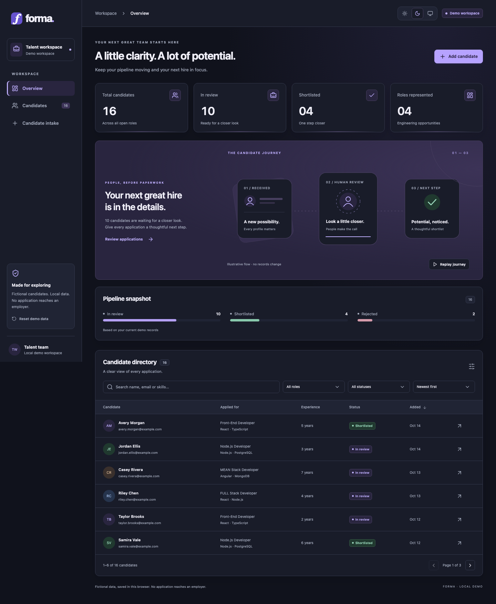

# Forma — Recruitment workspace

A frontend portfolio project that turns a legacy job-application interface into a cohesive recruitment dashboard. Forma makes a candidate pipeline easy to explore: review applications, inspect profiles, and move candidates between review, shortlist and rejection states.

**React 19 · TypeScript · Vite · React Router · Zod · Vitest · Playwright**

[Explore the live demo](https://userjobapp.netlify.app/) · [CI runs](https://github.com/bibhu-3214/Job-App-for-user/actions) · [Motion recording](artifacts/appearance/journey-motion.webm)

> **Interactive demo, not an application service.** Use fictional information only. Data stays in this browser; no application reaches an employer. There is no backend, authentication, email delivery or AI ranking.



## Explore the workflow

1. Start on **Overview** to see metrics calculated from the current candidate records.
2. Open **Candidates** to search by name, email or skills, combine role/status filters, sort and paginate. Query parameters preserve the view across reloads and shareable local URLs.
3. Use **Candidate intake** to add a fictional profile. Required fields and domain constraints are validated before saving.
4. Open a profile to edit details, shortlist, reject or reopen an application. Pending controls and inline feedback distinguish successful writes from failures.
5. Reload to confirm browser-local persistence, or use the confirmed **Reset demo data** action to restore the fixtures.

The interface adapts to desktop and mobile. Native dialogs support Escape, keyboard focus containment and restoration. Tables retain horizontal scrolling on small screens, and forms expose field-level validation errors.

<details>
<summary>More screenshots: intake, profile and mobile</summary>

### Candidate intake


### Profile and status actions


### Mobile overview


[View the mobile intake screenshot](artifacts/intake-mobile.png).

</details>

## Appearance and motion

The header offers **Light**, **Dark**, and **System** appearance controls. System is the default and follows OS changes. The choice is saved separately under `forma.appearance.v1`; resetting candidate data leaves it intact. Theme changes synchronize between tabs; candidate records still do not. If storage is blocked, the theme remains usable for this visit and the control reports that it could not persist the choice.

`public/theme.js` resolves the palette and canvas before React/CSS load, preventing a light canvas flash on dark startup. `ThemeControl.tsx` handles subsequent changes, system listeners and cross-tab updates. The small bootstrap intentionally has no dependency on the application bundle; browser tests check both startup and runtime behavior. Keep its storage key, accepted values and canvas colors aligned with the control when changing the theme contract.

The overview's candidate-journey graphic plays a finite 4.8-second sequence: dossier cards arrive, a profile passes through human review, and a shortlist check draws in. **Stop motion** ends it immediately; **Replay journey** restarts the scene and the pipeline chart reveals. It is an illustration, not automated screening, and does not mutate candidate records. On narrow screens, separate stage captions keep the sequence readable. When the browser reports reduced motion, the complete diagram is static, the control is disabled, and the reason is shown inline. The app never changes OS accessibility preferences.

[Watch the local motion demonstration](artifacts/appearance/journey-motion.webm). This isolated Chromium recording includes initial playback, replay, stop, and reduced-motion behavior. Automated checks compare the moving profile's transforms at two times and verify that all scene animations settle and that reduced-motion mode has no active animations.

Semantic CSS tokens cover surfaces, text, borders and statuses. Motion uses CSS transforms and opacity with finite sequences: staggered metrics, chart reveals, an illustrated candidate journey, list/filter entry, page changes, dialogs and save/error feedback. No animation library, external fonts, continuously moving backgrounds or animation-driven data updates are used. `prefers-reduced-motion: reduce` removes animation and transitions while preserving all information and actions.

[Light desktop](artifacts/appearance/light-desktop-overview.png) · [Dark mobile](artifacts/appearance/dark-mobile-overview.png) · [Dark intake](artifacts/appearance/dark-desktop-intake.png) · [Light mobile intake](artifacts/appearance/light-mobile-intake.png) · [Reduced-motion dialog](artifacts/appearance/dark-mobile-reduced-motion-dialog.png)

Release validation: 24 unit/component tests and seven isolated Chromium scenarios pass, including pre-React startup, persisted/system preference, denied storage, desktop/mobile themes, reduced motion, keyboard controls, select-arrow clearance at 320/390/1440px and the existing intake-to-reload workflow. Screenshots are review artifacts, not automated pixel-diff baselines. Safari/Firefox and physical-device rendering have not been verified for this enhancement.

## Local setup

Use Node.js 22.12+ and npm 10+.

```sh
npm ci
npm run dev
```

Open the local URL printed by Vite. To inspect a production build locally:

```sh
npm run build
npm run preview
```

## Validation

```sh
npm run lint
npm run typecheck
npm test
npm run build
npx playwright install chromium --only-shell
npm run test:e2e
```

Playwright uses an isolated headless browser and a loopback server, not your personal browser profile. To use a separately downloaded test browser, set `PLAYWRIGHT_BROWSERS_PATH`; optionally set `CHROMIUM_PATH` to its executable. Tests cover form validation, combined filtering, sorting, status transitions, persistence validation/recovery, full intake-to-reload flow, editing, reset confirmation, save failure, keyboard focus containment/restoration, legacy redirects and mobile overflow. The full workflow also asserts that no external requests occur. CI performs a clean install, lint, typecheck, unit tests, build and Chromium end-to-end tests, uploading screenshots and failure traces. See the linked CI runs for the exact commit and result; local results and a successful build do not by themselves confirm a Netlify publication.

## Engineering approach

- [`model.ts`](src/features/candidates/model.ts): Zod runtime schemas, domain types, status transitions and pure filter/sort helpers.
- [`repository.ts`](src/features/candidates/repository.ts): typed repository boundary, deterministic fixtures and versioned browser storage. Replacing this adapter is the integration seam for a future approved backend.
- `src/features/candidates/CandidateList.tsx`: the single reusable searchable/filterable/paginated directory.
- `src/features/candidates/CandidateForm.tsx`: shared validated create/edit form.
- `src/components/SelectControl.tsx`: native select behavior with a single inset chevron, reserved value padding and full-width filters on small phones. Forced-colors mode restores the system picker indicator.
- `src/features/appearance/ThemeControl.tsx`: light/dark/system controls, preference persistence and system/cross-tab synchronization.
- `src/features/overview/PipelineScene.tsx`: original finite SVG journey with Stop/Replay controls and a reduced-motion static alternative.
- `src/components/Modal.tsx`: native modal dialog with Escape, focus containment and focus restoration.
- `src/App.tsx`: workspace navigation, overview, intake and mutation orchestration. Mutations update React state only after a successful storage write; pending buttons and inline success/errors make the outcome explicit.
- `src/styles.css`: responsive visual system with local system typography, no font/CDN dependencies.

Sixteen deterministic fictional records use reserved `example.com` email addresses. The overview counts are computed, not hard-coded metrics. Dates display in UTC. New records use the actual local creation time, and identities use browser-generated UUIDs.

## Persistence and limitations

Storage key: `forma.candidates.v1`, envelope `{ version: 1, candidates: [...] }`. All records are validated on load and save, including duplicate IDs. Missing storage starts with fixtures. Malformed data, unsupported versions or denied reads show a recovery warning and temporary fixtures; writes stay blocked until the user confirms reset. Reset replaces saved records only after a successful write. Storage failures never report success or silently change the displayed records.

Local storage is unencrypted, origin-specific, limited by browser quota and removable by browser settings. Candidate records do not synchronize between tabs, and the last successful writer wins; only the appearance preference synchronizes. Clearing browser storage removes local changes. A future version must explicitly migrate its envelope rather than reinterpret unsupported data. There is no server authorization, multi-user concurrency, audit log, delivery service or production data protection. No production-readiness or legacy-service availability claim is made.

## Migration from CRA

Baseline: `bcc63ca40e4b7a60f99197b263e736cd15aefea0` on `master`.

CRA 4 / React 17 / Router 5 / Axios / Bootstrap CDN were replaced with Vite, React 19, TypeScript and current compatible Router dependencies. The legacy render-time fetches, duplicate role tables and stale mutation/details state were removed. Root `index.html` is now Vite's entry. Build output changes from `build/` to `dist/`; development changes from `npm start` to `npm run dev`. Future public build variables use `import.meta.env.VITE_*`, rather than `process.env.REACT_APP_*`. Never place secrets in either client environment format. No environment variables are required today.

Routes: `/home` redirects to `/`, `/register` to `/intake`, and `/dashboard/*` to `/candidates`, preserving known role links (`frontend`, `nodejs`, `meanstack`, `fullstack`) as role filters. Other unknown routes redirect to overview. `public/_redirects` supplies Netlify’s `/* /index.html 200` SPA fallback. Vite copies it into `dist/`, and CI checks that the built rule matches the source. Existing assets are served normally while application routes resolve to `index.html`.

The former HTTP Heroku API is disabled: there is no client or automatic request. Source-derived contracts, for migration planning only:

| Method | Path                                 | Payload                                          |
| ------ | ------------------------------------ | ------------------------------------------------ |
| GET    | `/users/application-forms`           | none                                             |
| GET    | `/users/application-form/:id`        | none                                             |
| POST   | `/users/application-form`            | name, email, phone, skills, jobTitle, experience |
| PUT    | `/users/application-form/update/:id` | status                                           |

Legacy record fields: `_id`, name, email, phone, skills, jobTitle, experience, createdAt, status. Domain IDs now use `id`; a future adapter must explicitly map `_id`, validate data, normalize experience/dates, and handle server errors. Status values remain `applied`, `shortlisted`, `rejected` (`applied` is displayed as “In review”). There were no demonstrated server edit, delete or login endpoints; local profile editing is a demo feature, not a claim about remote support. A real integration needs a separately designed and approved HTTPS backend, authorization, data governance and tests.

## Hosting and releases

The existing site is [userjobapp.netlify.app](https://userjobapp.netlify.app/), a manually deployed Netlify project with no linked Git repository. GitHub merges do not update it automatically. Publish only a verified `dist/` build to that existing project after deployment approval; no account, domain or repository-link changes are needed. The initial rebuild and routing fix retain `[skip netlify]` commit markers as a precaution for any future Git integration.

Build with Node.js 22.12+ using `npm ci && npm run build`. Upload the contents of `dist/`, including `_redirects` and `theme.js`, rather than the source directory or the former CRA `build/` directory. The site has automatic publishing enabled for manual uploads: uploading a production build replaces the public app. Verify `/`, `/candidates`, `/intake` and legacy redirects through direct visits and refreshes after every release. Also check theme persistence, journey playback/replay/Stop, reduced-motion fallback and select spacing on mobile. Inspect deploy history before retrying an interrupted upload; automatic publishing may have completed despite a lost browser connection.

The hosted app remains a fictional-data demo with browser-local storage and no employer delivery. Screenshots above were captured in isolated browser tests. Repository CI validates the build; publication and live-site verification are separate release steps.
